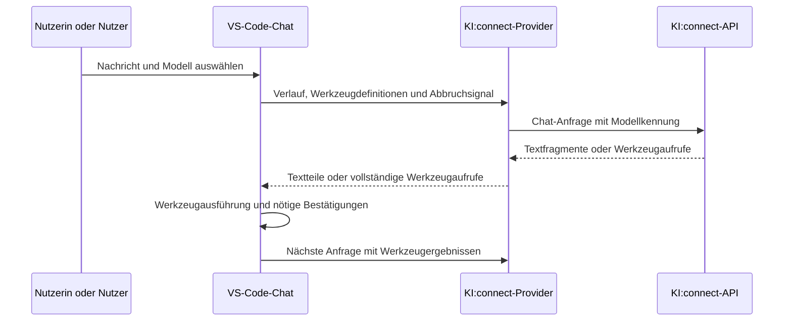

# Architektur

## Aufbau

| Modul | Verantwortung |
| --- | --- |
| `src/extension.ts` | Erweiterung aktivieren, Befehle registrieren und Schlüsseländerungen behandeln. |
| `src/provider.ts` | VS-Code-Provider implementieren, Nachrichten übersetzen und Antwortteile melden. |
| `src/api.ts` | HTTP-Anfragen, Modellliste und OpenAI-kompatiblen Antwortdatenstrom verarbeiten. |
| `src/models.ts` | Werkzeugfähigkeit aus Metadaten oder bekannten Familien ableiten. |
| `test/chat.test.cjs` | Verhalten mit simulierten HTTP-Antworten und einer kleinen VS-Code-Testumgebung prüfen. |

Es wird genau ein Provider unter der Kennung `kiconnect` registriert. Er liefert mehrere Modelle. Die Kennungen in `package.json` und bei der Registrierung müssen übereinstimmen.

## Nachrichtenweg

## Werkzeugaufrufe

VS Code übergibt Namen, Beschreibungen und Eingabeschemata verfügbarer Werkzeuge. Der Provider übersetzt sie in OpenAI-kompatible `tools`. `toolMode` wird als `tool_choice: auto` oder `required` übermittelt.

Im Antwortdatenstrom können mehrere Werkzeugaufrufe parallel und fragmentiert eintreffen. Der API-Client sammelt sie nach Index und prüft vor der Übergabe Kennung, Werkzeugname und JSON-Argumente. Unbekannte Werkzeuge und unvollständige Aufrufe führen zu einem Fehler. Die Erweiterung gibt vollständige Aufrufe als `LanguageModelToolCallPart` an VS Code zurück und führt sie nicht selbst aus.

In späteren Anfragen bleiben Assistentenaufrufe als `tool_calls` erhalten. Ergebnisse werden als `tool`-Nachrichten mit passender `tool_call_id` übertragen, bevor neuer Nutzertext folgt.

## Fähigkeiten und Grenzen

Explizite Angaben in `capabilities` oder `info.meta.capabilities` haben Vorrang. Erkannt werden auch Fähigkeitslisten mit `tools`, `tool_calling` oder `function_calling`.

Fehlen verwertbare Metadaten, werden GPT-OSS, Qwen 3 und Mistral Small 3/4 anhand ihres Namens als toolfähig eingeordnet. Das ersetzt keinen Test der konkreten Bereitstellung. E5-Mistral und unbekannte Familien bleiben ohne positive Angaben Textmodelle. Modelle mit `embed` oder `rerank` in Kennung oder Name werden aus der Chatmodellliste entfernt.

Bilder werden nicht unterstützt. Die gemeldeten Tokenbudgets sind feste Vorgaben; die Tokenzählung schätzt anhand der UTF-8-Bytes. Die Erweiterung liefert keine modellspezifische Tokenisierung.

## Abbruch und Lebenszyklus

Ein VS-Code-Abbruchsignal wird in einen `AbortController` übersetzt. Dadurch endet die zugehörige HTTP-Anfrage. Ereignisabonnements und Datenstromleser werden anschließend freigegeben.

Ändert sich der gespeicherte Schlüssel, meldet der Provider eine Änderung seiner Modellinformationen. VS Code kann die Modellliste daraufhin neu abfragen.
